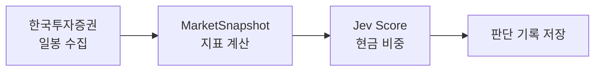

# MoneyPrinter

**KODEX 미국S&P500(H)** 를 오늘 얼마나 들고 있을지, TypeSafe의 판단 모델 **Jev**가 매일 정하는 리밸런싱 앱입니다. 주문은 비중 탭에서 확인한 뒤에만 나갑니다.

## 왜 비중인가

종목을 골라 S&P 500을 꾸준히 이기기는 어렵습니다. 그렇다고 전부 들고만 있으면, 몇 달씩 이어지는 하락에 계좌도 함께 무너집니다.

그래서 매일 한 가지만 묻습니다. 오늘 S&P 500 ETF를 얼마나 두고, 얼마를 현금으로 둘 것인가.

## 왜 Jev인가

사람이 매일 판단하면 그날 뉴스와 기분에 흔들립니다. Jev에는 매일 같은 지표와 같은 질문을 보내 같은 잣대로 판단하게 합니다.

Jev는 현금 0·25·50·75·100% 다섯 기준에 확률을 매겨 답하고, 앱은 그 답으로 현금 비율을 정합니다.

## 왜 차트 대신 지표인가

- **토큰.** 종가 200개를 매번 보내면 입력이 길어지고 비용이 늘어납니다.
- **셈.** "검은 고양이, 흰 고양이…"를 길게 늘어놓고 흰 고양이가 몇 마리인지 물으면 모델은 자주 틀립니다. 종가 200개로 평균이나 낙폭을 구하게 하는 것도 같은 일입니다. 셈은 코드가 하고, Jev는 판단만 합니다.

### Jev에 넘기는 지표

- **종목 코드, 마지막 거래일, 종가.** 어떤 종목의 어느 날 기준인지 알려 줍니다. 가격 수준만 보고 비싸다고 판단하지 말라고 질문에 적어 두었습니다.
- **200거래일 전 종가를 100으로 둔 가격.** 지난 200거래일 동안 얼마나 올랐거나 내렸는지 한 숫자로 보여 줍니다. 120이면 그 기간에 20% 올랐다는 뜻입니다.
- **20·60·200거래일 이동평균 대비 종가 괴리.** 지금 가격이 단기·중기·장기 평균보다 위인지 아래인지 봅니다. 200거래일 평균 위면 장기 상승 추세 안에 있고, 20거래일 평균 아래로 내려가면 단기 힘이 빠지고 있습니다.
- **200거래일 이동평균의 20거래일 변화.** 장기 추세가 어느 쪽으로 기울어 있는지 봅니다. 가격은 며칠 사이에 평균을 넘나들어도 이 기울기는 천천히 바뀝니다. 양수면 장기 추세가 오르는 중입니다.
- **20·60거래일 일간 수익률의 연율 변동성.** 하루하루 흔들리는 크기를 1년 기준으로 환산합니다. 20거래일 값이 60거래일 값보다 크게 높아지면 최근 시장이 불안해졌다는 신호입니다.
- **최근 200거래일 최고가 대비 종가.** 고점에서 얼마나 떨어져 있는지 봅니다. -3%면 고점 근처이고, -20%면 큰 하락 구간에 들어와 있습니다.
- **21·63·126거래일 수익률.** 약 1·3·6개월 동안의 성과입니다. 세 기간의 방향이 같은지, 짧은 기간만 엇갈리는지 봅니다.
- **MACD 히스토그램(12·26·9)의 종가 대비 퍼센트.** 짧은 상승 속도가 최근 평균보다 빨라지는지 느려지는지 봅니다. 양수면 탄력이 남아 있고, 음수로 돌아서면 상승 힘이 약해지고 있습니다. 종가 대비 퍼센트라 가격 수준이 다른 종목끼리도 같은 눈금으로 읽습니다.

아래 세 개는 무릎과 어깨를 보는 변화 지표입니다. 하루치 값만으로는 회복 중인지 꺾이는 중인지 구분할 수 없어서, 방향을 코드가 계산해 넣습니다.

- **MACD 히스토그램의 5거래일 변화.** 지금 히스토그램에서 5거래일 전 값을 뺀 차이입니다. 히스토그램이 음수여도 이 값이 양수면 회복 중이고, 히스토그램이 양수여도 이 값이 음수면 꺾이는 중입니다.
- **20거래일 이동평균의 5거래일 변화.** 단기 추세가 막 고개를 드는지, 숙이는지 봅니다. 200거래일 평균의 기울기보다 훨씬 빨리 바뀝니다.
- **종가가 60거래일 이동평균을 마지막으로 넘거나 깬 뒤 지난 거래일 수.** 중기 추세가 바뀐 지 얼마나 됐는지 봅니다. 위인지 아래인지는 60거래일 평균 대비 괴리의 부호로 압니다. 며칠 안 됐으면 막 바뀐 것이고, 오래됐으면 추세가 자리 잡은 것입니다.

질문에는 장기 추세·모멘텀·위험 세 영역으로 나눠 보고 합치는 규칙을 적어 두었습니다. 정확한 바닥이나 꼭대기는 노리지 않습니다. 자세한 내용은 [Jev](#jev) 절에 있습니다.

계산식과 JSON 키는 [지표](#지표) 절에 있습니다.

## 종목

| 화면 이름       | 종목                | 코드     | 쓰임        |
| --------------- | ------------------- | -------- | ----------- |
| KODEX SNP500(H) | KODEX 미국S&P500(H) | `449180` | 거래 대상   |
| KODEX 200       | KODEX 200           | `069500` | 참고용 판단 |

거래는 KODEX 미국S&P500(H) 하나로만 합니다. 이름의 (H)는 환헤지입니다. 환헤지를 하지 않은 미국 ETF는 원·달러 환율이 움직이는 만큼 가격도 함께 움직입니다. 그러면 지표가 미국 시장의 추세가 아니라 환율 변동을 섞어 읽게 되고, 환율 때문에 생긴 손실도 그대로 떠안습니다. 환헤지 상품은 이 환율 영향을 대부분 덜어 내, 가격과 지표가 S&P 500 자체의 흐름을 따릅니다.

KODEX 200은 정보 제공용입니다. 같은 지표와 같은 질문으로 국내 시장에 대한 Jev의 판단을 비교해 볼 수 있게 만들었고, 이 결과로 거래하지는 않습니다.

오늘 탭은 `449180`만 보여 줍니다. 비중 탭에서는 두 종목의 판단을 골라 볼 수 있습니다.

## 동작



1. 종목의 일봉을 기간을 나눠 받아 220거래일(200거래일 지표 + 200일 이동평균의 20거래일 변화)을 모읍니다. 한 번에 약 100건입니다.
2. 장이 끝나지 않은 오늘 일봉은 뺍니다. 서울 기준 15:40 전이면 오늘 일봉을 버리고 직전 거래일 종가까지만 씁니다.
3. 모은 일봉으로 정해 둔 지표만 계산해 `MarketSnapshot`을 만듭니다. 종가 목록은 Jev에 넣지 않습니다.
4. 그 종가 거래일에 판단이 없을 때만 Jev를 부릅니다. 같은 스냅샷으로 `systemone` Score 질문을 3번 보내고, 세 `score`와 `confidence`의 평균을 씁니다.
5. 현금 비중은 평균 `score / 4`입니다. 0은 전액 주식, 1은 전액 현금입니다. 기록에는 Jev가 낸 비중을 그대로 남깁니다. `confidence`는 주문할 때만 봅니다.
6. 요청 JSON, 세 응답 JSON, 회차별 답, 지표, 모델 이름, 입력 토큰 합계를 저장합니다.

판단은 종가 거래일마다 한 번입니다. 장 마감 뒤 처음 비중 탭을 열 때 그날 종가로 판단하고, 그 뒤로는 탭을 다시 열거나 새로고침해도 저장된 판단을 보여 줍니다. 장중이나 주말에 열면 직전 거래일 판단을 보여 주고, 그 판단이 없으면 직전 거래일 종가로 판단합니다.

저장 위치는 앱의 Application Support 안 `MoneyPrinter/cash-weights.json`입니다. 키는 `종가 거래일(yyyy-MM-dd)|종목코드`입니다. 3번 묻기 전의 기록은 호출한 날짜를 키로 썼고, 같은 거래일에 그런 기록만 있으면 새로 판단해 덮어씁니다.

## 지표

Jev가 시장 상황을 파악하도록, 일봉 종가와 고가로 아래 지표만 계산해 보냅니다. JSON 키는 줄임말 없이 계산 정의를 적습니다.

```swift
enum CodingKeys: String, CodingKey {
    case ticker = "index_symbol"
    case asOf = "last_trading_day"
    case latestClosingPrice = "latest_closing_price"
    case priceIndexed = "price_with_close_200_trading_days_ago_set_to_100"
    case priceVsMa20Pct = "percent_difference_from_20_trading_day_moving_average"
    case priceVsMa60Pct = "percent_difference_from_60_trading_day_moving_average"
    case priceVsMa200Pct = "percent_difference_from_200_trading_day_moving_average"
    case ma200Slope20dPct = "percent_change_of_200_trading_day_moving_average_over_prior_20_trading_days"
    case volatility20dPct = "annualized_percent_volatility_of_daily_returns_over_20_trading_days"
    case volatility60dPct = "annualized_percent_volatility_of_daily_returns_over_60_trading_days"
    case drawdownFrom200dHighPct = "percent_change_from_highest_high_of_last_200_trading_days"
    case return1mPct = "percent_return_over_prior_21_trading_days"
    case return3mPct = "percent_return_over_prior_63_trading_days"
    case return6mPct = "percent_return_over_prior_126_trading_days"
    case macdHistogramAsPercentOfClose = "histogram_of_12_minus_26_trading_day_exponential_moving_average_as_percent_of_closing_price"
    case macdHistogramChangeOver5dPct = "change_over_prior_5_trading_days_of_histogram_of_12_minus_26_trading_day_exponential_moving_average_in_percentage_points"
    case ma20Slope5dPct = "percent_change_of_20_trading_day_moving_average_over_prior_5_trading_days"
    case tradingDaysSinceCloseCrossedMa60 = "trading_days_since_close_last_crossed_60_trading_day_moving_average"
}
```

## 화면

| 탭   | 하는 일                                                     |
| ---- | ----------------------------------------------------------- |
| 계좌 | 국내 주식 잔고                                              |
| 오늘 | `449180`의 현재 가격과 지표                                 |
| 비중 | 선택한 ETF의 Jev 판단, 요청·응답 JSON, 지표, 이전 날짜 기록 |

### 계좌 현황


### 오늘기준 지표 계산


### 비중

거래 대상인 KODEX 미국S&P500(H)와 참고용인 KODEX 200을 고릅니다.


## 한국투자증권 Open API

시세와 잔고는 [한국투자증권 KIS Developers](https://apiportal.koreainvestment.com) Open API를 씁니다.

| 서버     | 주소                                   |
| -------- | -------------------------------------- |
| 실전투자 | `openapi.koreainvestment.com:9443`     |
| 모의투자 | `openapivts.koreainvestment.com:29443` |

`URL_BASE`에는 `https://`를 넣지 않습니다. `//`가 xcconfig 주석이 됩니다. 예제 설정의 기본값은 모의투자 주소입니다.

지금 코드의 `APIConfigManager.isDemo`는 `false`입니다. 잔고 조회 `tr_id`는 실전 코드를 씁니다. 모의투자 서버를 쓰면 이 값도 `true`로 맞춰야 합니다.

앱이 실제로 호출하는 API는 다음과 같습니다.

| 용도           | 메서드·경로                                                           | tr_id                               |
| -------------- | --------------------------------------------------------------------- | ----------------------------------- |
| 접근 토큰      | `POST /oauth2/tokenP`                                                 | -                                   |
| 국내 ETF 일봉  | `GET /uapi/domestic-stock/v1/quotations/inquire-daily-itemchartprice` | `FHKST03010100`                     |
| 국내 주식 잔고 | `GET /uapi/domestic-stock/v1/trading/inquire-balance`                 | 실전 `TTTC8434R` / 모의 `VTTC8434R` |

국내 일봉의 `fid_org_adj_prc`는 `1`입니다. 접근 토큰은 키체인에 저장하고, 만료 전에 다시 씁니다.

해외 지수 일봉, 해외 잔고, 현재가, 재무 조회용 엔드포인트도 코드에 있습니다. 현금 비중 판단은 국내 ETF 일봉만 사용합니다.

주문은 `POST /uapi/domestic-stock/v1/trading/order-cash`입니다. 매수는 실전 `TTTC0802U`, 매도는 `TTTC0801U`이고, 모의투자는 `VTTC0802U` / `VTTC0801U`입니다. 본문의 hashkey를 `POST /uapi/hashkey`로 받은 뒤 시장가(`ORD_DVSN=01`)로 한 번만 보냅니다. 주문 요청은 재시도하지 않습니다.

## Jev

`POST https://api.typesafe.ai/v1/systemone`에 Score 질문 하나를 보냅니다. 질문 ID는 `cash_weight`이고, 모델은 `jev-latest`입니다.

질문은 지표를 세 영역으로 나눠 보게 합니다. 두 종목의 질문 본문은 같고, 첫 문장의 ETF 이름만 다릅니다.

- **장기 추세(가장 우선).** 200거래일 평균 대비 위치와 그 평균의 기울기가 핵심이고, 20·60거래일 평균은 보조입니다.
- **모멘텀.** 1·3·6개월 수익률, MACD 히스토그램과 5거래일 변화, 20거래일 평균의 기울기, 60거래일 평균 교차 뒤 경과일입니다. 경과일은 60거래일 평균 대비 괴리의 부호와 함께 읽습니다.
- **위험.** 20·60거래일 변동성(20일 값이 60일 값보다 크게 높은지), 200거래일 고점 대비 낙폭, 하루 수익률입니다. 위험 신호 하나만으로는 비중을 줄이지 않고, 여러 지표에서 함께 보일 때 줄입니다.

세 영역을 합치는 규칙도 적어 둡니다. 장기 상승 중이라도 단기 모멘텀이 약해지면 비중 확대를 보류하고, 변동성 급등과 큰 낙폭이 같이 오면 ETF 비중을 제한하고, 영역끼리 충돌하면 극단 대신 중간 칸을 고릅니다.

기준은 현금 비중 다섯 칸이고, 칸마다 해당하는 시장 상태를 적었습니다.

- `0% cash. Strong long-term uptrend, positive and strengthening momentum, low risk.`
- `25% cash. Uptrend dominates. Momentum is positive or only mildly fading, and risk is moderate at most.`
- `50% cash. Mixed or uncertain. Trend, momentum, and risk point in different directions.`
- `75% cash. Downtrend dominates, or risk is rising across several indicators.`
- `100% cash. Strong long-term downtrend, negative momentum, very high risk.`

`score`는 0부터 4까지 칸 번호의 확률 가중 평균이라 소수가 될 수 있습니다. 같은 입력에도 답이 조금씩 달라서, 3번 물은 `score`의 평균을 씁니다. 현금 비중은 그 평균을 4로 나눈 뒤 0과 1 사이로 자릅니다. 응답의 `model`과 세 번의 입력 토큰 합계도 함께 저장합니다.

## 주문

비중 탭에서 KODEX 미국S&P500(H)의 **잔고와 비교**를 누르면, 예수금과 보유 수량·현재가로 목표 주식 수를 계산합니다. 차이가 계좌 평가금액의 10% 이상이고 평일 09:00–15:20(서울)일 때만 주문 버튼이 나옵니다. 10%는 Jev 기준 한 칸(25%)의 절반 가까이라, 같은 장세에서 매일 생기는 Score 흔들림과 가격 변동으로는 주문하지 않습니다. 주문할 때는 목표 수량까지 한 번에 맞춰, 다음 날 남은 차이가 다시 문턱에 걸리지 않게 합니다. 세 `confidence`의 평균이 0.5 미만인 날은 Jev가 확신하지 못한 날로 보고 주문하지 않습니다. 버튼을 누르고 확인해야 시장가 주문이 전송됩니다. KODEX 200은 주문하지 않습니다. 휴장일은 걸러 내지 않습니다.

## 아직 없는 것

- 탭을 열면 자동으로 주문
- 지정가, 휴장일 달력

## 프로젝트 구조

```
MoneyPrinter/
├── MoneyPrinter/
│   ├── Core/
│   │   ├── Networking/          # HTTP, 재시도, 에러
│   │   └── Storage/             # 키체인
│   ├── Features/
│   │   ├── Jev/                 # systemone 클라이언트와 Score 모델
│   │   ├── KoreaInvestment/     # 시세, 잔고, 토큰, 설정
│   │   └── Trading/             # MarketSnapshot, 현금 비중, 기록
│   └── UI/
│       ├── Common/              # Theme, DisplayNumber, MetricRow 등 공통 UI
│       ├── Account/             # 계좌 탭
│       ├── Snapshot/            # 오늘 탭
│       ├── CashWeight/          # 비중 탭과 판단 상세 화면
│       ├── History/             # 기록 탭
│       └── Backtest/            # 최근 100거래일 백테스트 (기록 탭 우측 상단)
├── MoneyPrinterTests/           # 리밸런싱 계산, API 엔드포인트 테스트 (Cmd+U)
├── Info.plist                   # $(APP_KEY) 등 빌드 설정 참조
├── MoneyPrinter.xcconfig
├── Config.example.xcconfig
└── Config.xcconfig              # 실제 키. git에 올라가지 않음
```

## 시작하기

1. 설정 파일을 만듭니다.

   ```bash
   cp Config.example.xcconfig Config.xcconfig
   ```

2. `Config.xcconfig`에 값을 넣습니다. [TypeSafe 콘솔](https://console.typesafe.ai/keys)의 `TYPESAFE_API_KEY`, [KIS Developers](https://apiportal.koreainvestment.com)의 `APP_KEY`, `APP_SECRET`, `CANO`, `ACNT_PRDT_CD`, `URL_BASE`입니다.

3. Xcode에서 `MoneyPrinter.xcodeproj`를 열고 앱을 다시 빌드합니다. 키는 `Info.plist`의 `$(변수)`로 들어가므로, 값을 바꾼 뒤에는 다시 빌드해야 합니다.

## 참고

- [TypeSafe API 문서](https://docs.typesafe.ai/api)
- [Jev 모델 정보](https://docs.typesafe.ai/models)
- [한국투자증권 KIS Developers](https://apiportal.koreainvestment.com)
- [한국투자증권 Open API 공식 예제](https://github.com/koreainvestment/open-trading-api)

## 주의

이 프로젝트는 개인 학습과 실험용입니다. 투자 판단과 그 결과의 책임은 사용자에게 있습니다. `APIConfigManager.isDemo`가 `false`이면 주문은 실전 계좌로 나갑니다.
